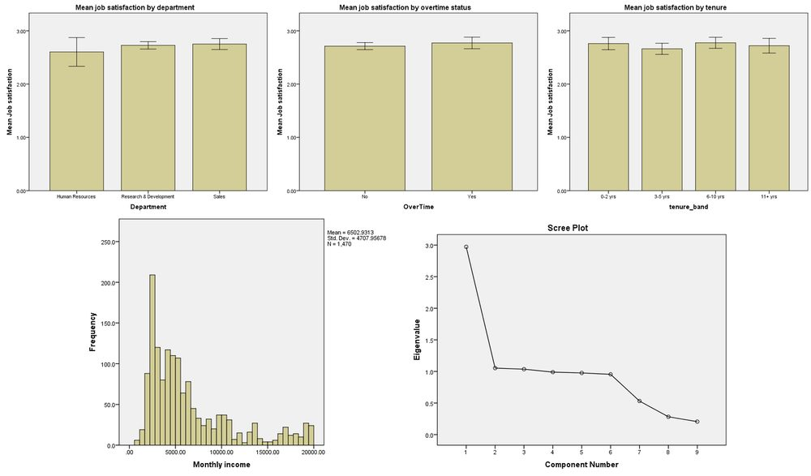

# Employee Engagement Analysis

**Tool:** SPSS

SPSS survey analysis of 1,470 employees from the IBM HR Analytics dataset. Asks what drives job satisfaction and whether it differs across departments and groups.

## Highlights
- Mean job satisfaction (1 to 4) stays between 2.6 and 2.8 across departments, overtime status and tenure bands
- No significant gap between departments: ANOVA p = .605, Welch p = .593
- Factor analysis (KMO .81) finds three components explaining 56% of variance

## Files
- `project2_employee_engagement.sps`
- `hr_output.doc`
- `hr_employee_attrition.sav`

`hr_employee_attrition.sav` is the IBM HR Analytics dataset, `project2_employee_engagement.sps` is the syntax and `hr_output.doc` is the write-up with charts.

## How to open
Open the `.sav` in IBM SPSS Statistics, then open and run the `.sps` syntax.

---
By Faaz Mistry · [LinkedIn](https://www.linkedin.com/in/faaz-mistry-369a11246/) · faazmistry110@gmail.com
